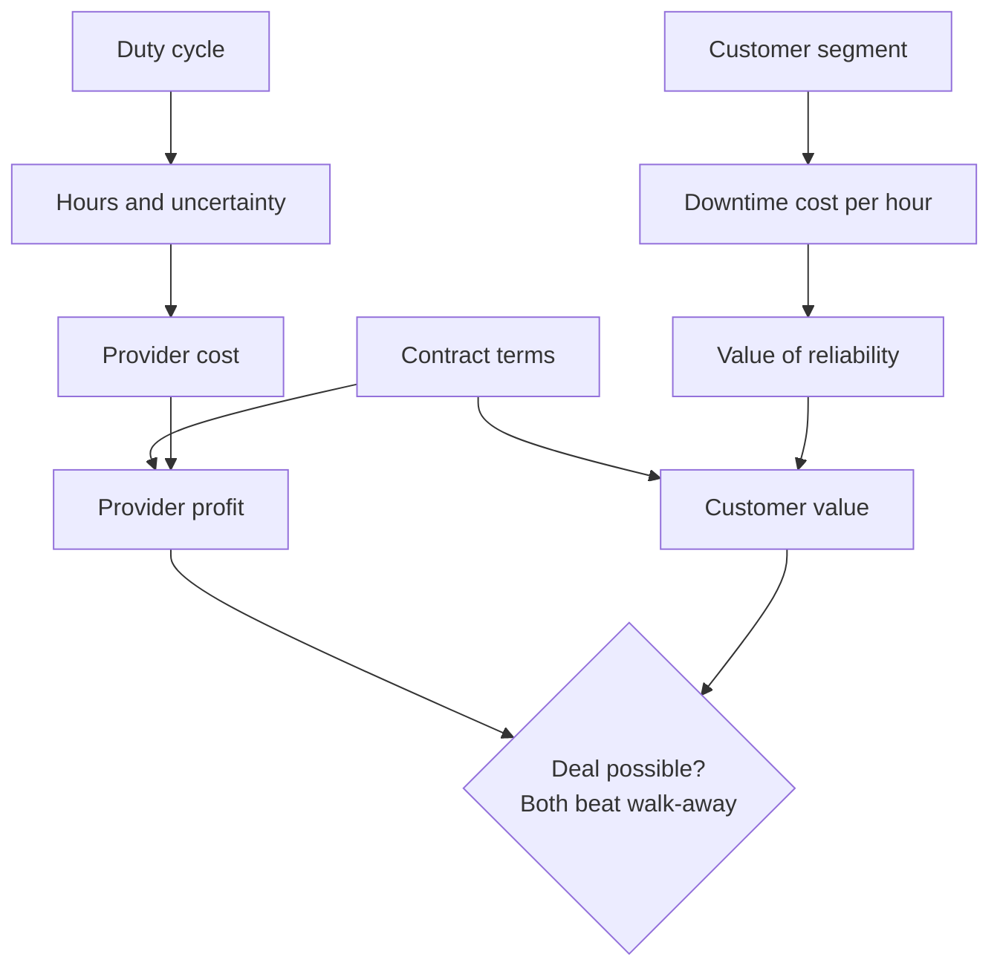

# GT ServiceDeal: Design
 
Design decisions for the simulation. Every value says where it came from:
- **[Source]**: a published public source (details in `research_numbers.md`)
- **[Assumption]**: my own estimate, tested in sensitivity checks on Day 4
- **[Design choice]**: a simplification to keep the simulation workable
## 1. Contract terms
 
Agents can only offer values from this table, so every offer is valid and can be scored.
 
| # | Term | Allowed values | Where it came from |
|---|---|---|---|
| 1 | Annual fee (year 1) | $1.5M–$12M, in $0.1M steps | [Assumption] Covers the estimated O&M baseline of $2.5M (peaking) to $6.4M (industrial) for a 105 MW aeroderivative plant, with room below for discounts and above for margin and extras. Baseline from EIA O&M costs [Source] |
| 2 | Pricing model | Fixed / Hybrid / Per-hour | [Design choice] Based on the common industry split of fixed, usage-based and mixed pricing (`notes_service_contracts.md`, section 4) |
| 3 | Escalation | 2.0%–5.0% per year, in 0.5% steps | [Assumption] Centred on the latest US annual inflation of 3.7% (September 2026) [Source: BLS] |
| 4 | Contract length | 5, 7, 10 or 15 years | [Assumption] Typical long-term service agreement lengths of 5–15+ years |
| 5 | Availability guarantee | 95.0%–98.0%, in 0.5% steps | [Assumption] Typical guarantee range for gas turbine service contracts |
| 6 | Penalty cap | 5%–30% of annual fee, in 5% steps | [Assumption] Caps are commonly a percentage of the annual fee |
| 7 | Scope | Repairs, Engines, Rotables: each yes/no (at least one yes) | [Design choice] Common industry grouping of aftermarket service types |
| 8 | Lease engine during overhauls | Yes / No | [Design choice] Simplest form of the "extras" term |
 
### How the pricing model works
The annual fee is **always agreed as the price at the customer's expected
running hours**, so offers stay comparable across pricing models. [Design choice]
 
The pricing model decides how much of the fee changes if the turbine runs more
or less than expected:
 
| Model | Fixed part | Part that scales with actual hours |
|---|---|---|
| Fixed | 100% | 0% |
| Hybrid | 50% | 50% |
| Per-hour | 10% (readiness fee) | 90% |
 
[Design choice] Split percentages chosen to give three clearly different levels of usage risk.
 
### How scope affects provider cost
Each service type covers a share of the full maintenance cost (the O&M baseline):
 
| Service type | Share of O&M cost |
|---|---|
| Engines | 50% |
| Rotables | 25% |
| Repairs | 25% |
 
[Assumption] Engine work (overhauls, exchanges) is the largest cost, so it gets
the largest share. A full-scope contract (all three) covers 100% of the baseline.
 
## 2. Customer personas
 
All personas use the same reference plant: a 105 MW aeroderivative gas turbine
plant [Source: EIA reference plant]. Personas differ only in **duty cycle**
(how it runs) and **segment** (who owns it).
 
| | 1. Industrial / O&G | 2. Utility | 3. Utility | 4. Data centre |
|---|---|---|---|---|
| Duty cycle | Industrial | Mid-merit | Peaking | Baseload |
| Expected hours/year | 8,000 | 3,500 | 1,000 | 8,300 |
| Starts/year | 10 | 200 | 120 | 15 |
| Usage uncertainty | ±5% | ±30% | ±50% | ±5% |
| Downtime cost/hour | $150k | $10k | $20k | $300k |
| Provider O&M cost (full scope) | ≈ $6.4M | ≈ $3.9M | ≈ $2.5M | ≈ $6.5M |
| Budget multiplier | 1.6× | 1.3× | 1.3× | 1.85× |
| Maximum budget (annual fee) | ≈ $10.2M | ≈ $5.1M | ≈ $3.3M | ≈ $12.1M |
| Walk-away cost (year 1) | ≈ $102M | ≈ $6.7M | ≈ $4.1M | ≈ $206M |
| Expected priorities | Availability, broad scope, fixed fee | Low cost, hybrid pricing, flexibility | Per-hour pricing, low fee, reliable starts | Availability, lease engine, penalty cap |
 
### Where each row came from
 
| Row | Where it came from |
|---|---|
| Duty cycle | [Design choice] The four duty cycles from `notes_service_contracts.md` |
| Expected hours/year | Peaking: [Source] peaking units run under 1,500 h/year. Others: [Assumption] within the ranges in `research_numbers.md`, section 2 |
| Starts/year | Peaking: [Source] fleet average about 100–150 starts/year. Others: [Assumption]. Not used in cost maths in v1, because EIA costs are per MWh |
| Usage uncertainty | [Assumption] Continuous-duty units are predictable; peakers depend on weather and prices |
| Downtime cost/hour | All four are [Assumption], informed by sources. Data centre $300k: Uptime Institute reports costs per outage (57% over $100k, one in five over $1M), not per hour, so the hourly figure is an estimate. Industrial $150k: below Senseye/Siemens' ~$220k/hour for oil and gas, within ABB's $10k–$500k/hour range, since one turbine outage doesn't always stop a whole site. Utilities: lost sales ≈ 105 MW × ~$55/MWh ≈ $5.8k/hour; mid-merit rounded up to $10k (replacement power, grid commitments), peaking $20k (runs during price spikes) |
| Provider O&M cost | [Source] EIA: $18.35/kW-year fixed + $5.29/MWh variable × 105 MW × expected hours |
| Budget multiplier | Utility 1.3×: [Calculated] cost + value of better reliability (better availability than the alternative saves roughly 0.25–0.45× cost). Industrial 1.6× and data centre 1.85×: [Assumption] their reliability value (5–12× cost) is far above any realistic contract price, so headroom is capped below 2× cost, with the highest for the highest downtime cost |
| Maximum budget | Calculated: O&M cost × budget multiplier |
| Walk-away cost (year 1) | Calculated: O&M cost + (1 − 92%) × hours × downtime cost. See "Walk-away option" below |
| Expected priorities | From `notes_service_contracts.md`. **Not instructions to the agents**: the scoring creates these preferences. Used to check whether agents behave realistically |
 
### Walk-away option (all personas)
If no deal is reached, the customer uses a third-party or pay-per-repair
alternative:
- Annual cost: **100% of the provider's O&M cost** [Assumption] No contract
  discount, plus the customer's own effort managing repairs
- Availability: **92%** [Assumption] Slower access to parts and no engine swaps
- No lease engine
These values were set by the Day 1 calibration check (section 4): with a cheaper
alternative (90% of cost, 94% availability), peaking utilities had no possible deal.
 
A customer only signs a deal that beats this alternative.
 
### How downtime is counted
Hours lost = (1 − availability) × expected running hours [Design choice].
A peaker is only hurt by downtime when it would have been running. This is a
simplified, demand-weighted approach in the spirit of the industry's EFORd
measure (outages counted only when the unit is needed). It assumes outages are
spread evenly across running hours, and that the provider delivers the
guaranteed availability (the risk of missing it is handled through expected
penalties in section 4).
 
### Scenario variation
Each run of the experiment uses a slightly different version of the persona, so
results don't depend on one exact set of numbers. For each run, these values are
randomly varied by up to **±10%** around the persona values: expected hours,
downtime cost and budget multiplier [Design choice]. A fixed random seed per run
means every setup is tested on exactly the same scenarios.
 
## 3. How the variables connect
 

 
## 4. Scoring
 
These formulas are used in two ways:
- **During the negotiation, as tools:** each side can check its own score for any
  offer it is considering (provider via the pricing analyst's cost calculator,
  customer via its offer calculator). Neither side ever sees the other side's score.
- **After the negotiation, as the benchmark:** both scores are calculated for the
  final deal and for every possible deal (section 7).
Agents never calculate anything themselves: the formulas run as Python code.
 
### Symbols
 
| Symbol | Meaning |
|---|---|
| F | Annual fee in year 1 (negotiated) |
| e | Escalation per year (negotiated) |
| L | Contract length in years (negotiated) |
| A | Availability guarantee (negotiated) |
| P | Penalty cap, % of annual fee (negotiated) |
| s | Scope share: engines 0.5 + rotables 0.25 + repairs 0.25, for those included |
| H | Expected running hours per year (persona) |
| U | Usage uncertainty (persona) |
| D | Downtime cost per hour (persona) |
| C | Provider's full-scope O&M cost in year 1 (persona) |
 
### Fixed settings
 
| Setting | Value | Where it came from |
|---|---|---|
| Cost inflation (provider's costs rise each year) | 3.5% | [Assumption] Close to latest US inflation of 3.7% [Source: BLS] |
| Discount rate (to compare years in today's money) | 8% | [Assumption] Typical corporate discount rate |
| Cost of each +1% availability above 95% | +4% of provider cost | [Assumption] Higher guarantees need more spares and faster response |
| Chance the provider misses the guarantee | 95%: 10%, 96%: 25%, 97%: 40%, 98%: 55% | [Assumption] Higher guarantees are harder to meet |
| Lease engine cost to provider | 5% of C per year | [Assumption] |
| Lease engine benefit to customer | +1 percentage point of effective availability | [Assumption] Shorter outages during overhauls |
| Cost of uncovered services to customer | 110% of the uncovered share of C | [Assumption] Paying per repair costs more than a contract |
| Risk weight (cost of uncertain usage) | 0.5 | [Assumption] |
 
### Provider profit (per year t)
 
```
Revenue         = F × (1 + e)^(t−1)
Service cost    = C × s × (1.035)^(t−1)
Availability    = Service cost × 4% × (A − 95)
Lease engine    = 5% × C × (1.035)^(t−1), if included
Expected penalty= chance of missing A × P × Revenue
Usage risk      = 0.5 × U × Revenue × |cost share that varies with hours − fee share that varies with hours|
 
Profit          = Revenue − Service cost − Availability − Lease engine − Expected penalty − Usage risk
```
 
**Provider score** = total profit over L years, discounted at 8% per year.
 
The fee share that varies with hours comes from the pricing model (fixed 0%,
hybrid 50%, per-hour 90%). The cost share that varies with hours is the
variable O&M share for that persona (EIA variable cost ÷ total cost).
 
### Customer value (per year t)
 
```
Fee paid        = F × (1 + e)^(t−1)
Uncovered cost  = 110% × C × (1 − s) × (1.035)^(t−1)
Downtime cost   = (1 − effective availability) × H × D
Penalty received= chance of missing A × P × Fee paid
Usage risk      = 0.5 × U × Fee paid × fee share that varies with hours
 
Deal cost       = Fee paid + Uncovered cost + Downtime cost − Penalty received + Usage risk
 
Walk-away cost  = 100% × C × (1.035)^(t−1) + (1 − 92%) × H × D
 
Customer value  = Walk-away cost − Deal cost
```
 
**Customer score** = total customer value over L years, discounted at 8% per year.
 
### When a deal is acceptable
 
| Side | Accepts only if |
|---|---|
| Customer | Customer score > 0 (beats walk-away) **and** year-1 fee F ≤ maximum budget |
| Provider | Provider score > 0 **and** passes all risk reviewer rules |
 
If no offer satisfies both, the best outcome is **no deal**. Agents that still
agree have made a mistake, which the evaluation flags.
 
### Calibration check
For each persona, check that at least one set of terms satisfies both sides.
 
**Day 1 result:** with the walk-away set at 90% of cost and 94% availability,
peaking utilities had **no possible deal** and mid-merit utilities very few.
Changed to 100% of cost and 92% availability. Number of acceptable term
combinations after the change (sampled grid):
 
| Persona | Acceptable combinations | Negotiation room |
|---|---|---|
| Industrial | ~215,000 | Wide |
| Data centre | ~286,000 | Wide |
| Mid-merit utility | ~14,000 | Narrow |
| Peaking utility | ~2,300 | Very narrow |
 
Utilities have much less room to negotiate than high-downtime customers. Repeat
this check on Day 4 whenever an assumption changes.
 
## 5. Provider limits and risk reviewer rules
 
The risk reviewer blocks any offer from the sales agent that breaks these rules
and explains why.
 
| # | Rule | Why | Where it came from |
|---|---|---|---|
| R1 | Penalty cap ≤ 20% of annual fee | Limits the maximum yearly loss | [Assumption] Caps are commonly a % of fee (`notes_service_contracts.md`, section 5) |
| R2 | Expected margin ≥ 10% (profit ÷ revenue, over the contract) | Every deal must be meaningfully profitable | [Assumption] |
| R3 | If length ≥ 10 years, escalation ≥ 2.5% | Long contracts need protection against rising costs | [Assumption] Cost inflation of 3.5% |
| R4 | 98% availability only with full scope | The provider needs control of all service types to promise the highest guarantee | [Design choice] |
 
The sales agent knows these rules exist but can still make mistakes. The risk
reviewer is the check. In Setup B (no risk reviewer), breaking these rules is
counted as a failure.
 
## 6. Agents: what each one knows and can do
 
Agents decide by reasoning from their private brief, like a person would. They
never see the formulas or the other side's information, but their tools return
their own side's numbers for any offer they check. The full scoring of both sides
is used **afterwards** to judge whether they decided well.
 
| Agent | Knows (private brief) | Tools | Goal |
|---|---|---|---|
| Customer | Its persona: hours, usage uncertainty, downtime cost, budget, walk-away option, priorities | **Offer calculator:** shows its value vs the walk-away option and whether the fee is within budget | Get the best deal it can, or walk away if the alternative is better |
| Sales | The provider's goals; that deals must be profitable; that risk rules exist | Can ask the pricing analyst | Close a profitable deal |
| Pricing analyst | The provider's cost model | **Cost calculator:** provider cost, profit and margin for any offer | Give sales accurate numbers |
| Risk reviewer | The four risk rules (section 5) | Rule checker | Block offers that break the rules, with a reason |
 
**Each turn, an agent chooses one action:** make an offer, counter-offer, accept,
or walk away.
 
**Why the customer gets a calculator [Design choice]:** the provider has a pricing
analyst, so without a calculator the customer would be at an unfair disadvantage.
Real customers also have finance teams that evaluate offers.
 
**Extra experiment:** run some negotiations where the customer has **no
calculator** and must judge offers from its brief alone. This tests whether the
side with better analysis gets the better deal.
 
### Possible outcomes (judged by the scoring)
 
| Agents' decision | Scores say | Outcome |
|---|---|---|
| Agreed | Both scores positive | Good deal |
| Agreed | One score negative | Bad deal |
| No deal | A deal good for both was possible | Missed deal |
| No deal | No deal could benefit both | Correct no deal |
 
## 7. Evaluation: benchmarking the agents
 
After each negotiation, the agents' result is compared with the best deals that
were possible. This is a **multi-objective optimisation**: two goals (provider
score and customer score) under constraints.
 
| Optimisation part | In this project |
|---|---|
| Decision variables | The 8 contract terms (section 1) |
| Objectives | Maximise provider score; maximise customer score (section 4) |
| Constraints | Both scores > 0 (beat walk-away), fee ≤ customer budget, all risk rules pass (section 5) |
| Solution | The Pareto frontier: deals where neither side can gain without the other losing |
| Method | Grid search: every combination of allowed term values is scored |
 
[Design choice] Grid search is used because every term has a fixed list of values,
so the number of possible deals is finite (about 5 million per scenario) and
checking them all guarantees the true best deals are found.
 
### Steps
1. List every possible deal from the allowed values in section 1.
2. Score each deal for both sides with the section 4 formulas.
3. Keep only acceptable deals (the zone of possible agreement).
4. Find the Pareto frontier among them.
5. Compare the agents' outcome with the frontier.
### Measures
 
| Measure | Meaning |
|---|---|
| Outcome | Good deal / bad deal / missed deal / correct no deal (section 6) |
| Value left on the table | How much better a deal for **both** sides existed |
| Share of value captured | Agents' total value (provider + customer) ÷ best possible total |
| Value split | Share of the total value that went to each side |
| Rule violations | Any risk rule broken in the final deal |
 
### Limitation
"Best" means best **according to this model's formulas and assumptions**, not
necessarily in the real world. Sensitivity checks on Day 4 test how much the
findings depend on the assumptions.
 
## 8. Negotiation protocol
 
| Rule | Value | Where it came from |
|---|---|---|
| Who opens | Sales makes the first offer | [Design choice] |
| Turn order | Sales → (pricing analyst if sales asks) → risk reviewer → customer → sales … | [Design choice] |
| Risk review | Every sales offer is checked before the customer sees it; blocked offers go back to sales with the reason | [Design choice] |
| Customer actions | Accept, counter-offer, or walk away | [Design choice] |
| Sales actions | Offer, revise, accept the customer's counter-offer, or walk away | [Design choice] |
| Round limit | 12 rounds (one sales turn + one customer turn = one round); no agreement by then = no deal | [Assumption] Long enough to negotiate, short enough to control cost |
| Offer format | Every offer is a structured set of the 8 terms (section 1) plus a short message | [Design choice] Lets every offer be validated and scored |
| Invalid offers | Values outside section 1 are rejected and the agent is asked to try again | [Design choice] |
 
## 9. Experiments
 
Each setup runs on the same scenarios (same random seeds) so results can be
compared fairly.
 
| Setup | Agents | Model | Question |
|---|---|---|---|
| A (baseline) | All 4 | Claude Haiku 5.5 | Reference point |
| B | No risk reviewer | Claude Haiku 5.5 | Does the guardrail prevent bad deals? |
| C | No pricing analyst | Claude Haiku 5.5 | Does cost analysis lead to better deals? |
| D | All 4 | Claude Sonnet 5.5 | Does a stronger model negotiate better? |
| E (optional) | All 4, customer without calculator | Claude Haiku 5.5 | Does the side with better analysis get the better deal? |
 
Planned runs: about 30 per persona for Setups A, B, C and E (120 per setup), and
about 12–15 per persona for Setup D (50–60 runs), because the stronger model costs
more. See the cost plan in the 7-day plan.
 